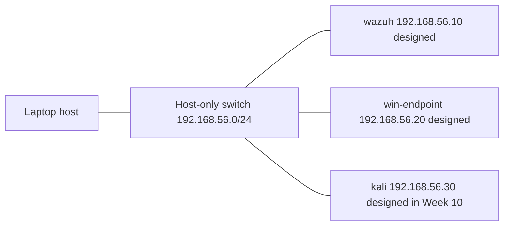

# Network map

Label every box **designed** or **observed** before you submit this. A designed address is a plan. An observed address is one you read on a machine you run.

The home router and the rest of the house stay off this diagram on purpose. The lab uses host-only so a later assessment VM is not sitting on the family LAN. Updates can use a separate NAT adapter, which you can disable during an assessment.

## Packet trace

Choose one flow and fill the row. Leave the evidence cell blank until you have a note or a screenshot from your own machine.

| Step | Device | Address you expect | What the packet is doing | Observed? |
| --- | --- | --- | --- | --- |
| 1 | Your laptop |  | Starts the connection |  |
| 2 | VirtualBox host-only adapter | 192.168.56.1 is the usual host address | Forwards lab traffic only |  |
| 3 | Destination VM |  | Replies, or does not |  |

## What I still cannot see

Write the gaps here. A good map names what you did not capture.
