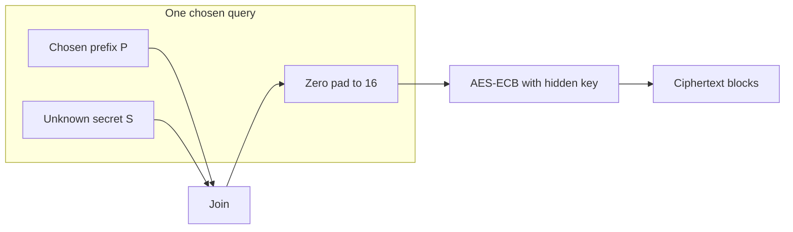

# Worked answers — Week 7 cryptography assignment

**Course:** Maxim Nyansa cybersecurity bootcamp.  
**Trainee:** James Ackah Blay.  
**Date of the assignment:** 16 November 2026.

These are study answers. They are not a claim that a live system was broken. Question 5 is demonstrated only against the local oracle in `ecb_byte_at_a_time.py`.

## Question 1 — Caesar cipher

The ciphertext is `XLMW MW E WIGVIX QIWWEKI`. A Caesar cipher moves each letter a fixed number of places and leaves spaces alone. There are 25 possible shifts. `caesar.py` scores each result for common English words and letter frequency.

The winning shift is **4**. Decrypting by 4 places gives:

**THIS IS A SECRET MESSAGE**

Check by hand on the first word: X→T, L→H, M→I, W→S.

All 25 candidates, best score first, from `python3 caesar.py brute "XLMW MW E WIGVIX QIWWEKI"`:

| Shift | Score | Plaintext |
| ---: | ---: | --- |
| 4 | 47.51 | THIS IS A SECRET MESSAGE |
| 22 | 12.04 | BPQA QA I AMKZMB UMAAIOM |
| 8 | 6.35 | PDEO EO W OAYNAP IAOOWCA |
| 18 | 5.39 | FTUE UE M EQODQF YQEEMSQ |
| 19 | 5.13 | ESTD TD L DPNCPE XPDDLRP |
| 15 | 4.90 | IWXH XH P HTRGTI BTHHPVT |
| 3 | 4.68 | UIJT JT B TFDSFU NFTTBHF |
| 5 | 4.10 | SGHR HR Z RDBQDS LDRRZFD |
| 16 | 4.08 | HVWG WG O GSQFSH ASGGOUS |
| 17 | 4.05 | GUVF VF N FRPERG ZRFFNTR |
| 20 | 3.96 | DRSC SC K COMBOD WOCCKQO |
| 23 | 3.72 | AOPZ PZ H ZLJYLA TLZZHNL |
| 9 | 3.62 | OCDN DN V NZXMZO HZNNVBZ |
| 14 | 3.43 | JXYI YI Q IUSHUJ CUIIQWU |
| 12 | 3.42 | LZAK AK S KWUJWL EWKKSYW |
| 2 | 3.39 | VJKU KU C UGETGV OGUUCIG |
| 21 | 3.38 | CQRB RB J BNLANC VNBBJPN |
| 10 | 3.14 | NBCM CM U MYWLYN GYMMUAY |
| 11 | 2.95 | MABL BL T LXVKXM FXLLTZX |
| 1 | 2.93 | WKLV LV D VHFUHW PHVVDJH |
| 6 | 2.87 | RFGQ GQ Y QCAPCR KCQQYEC |
| 24 | 2.75 | ZNOY OY G YKIXKZ SKYYGMK |
| 7 | 2.26 | QEFP FP X PBZOBQ JBPPXDB |
| 25 | 2.23 | YMNX NX F XJHWJY RJXXFLJ |
| 13 | 2.07 | KYZJ ZJ R JVTIVK DVJJRXV |

**Why shift 4 wins.** It is the only line that splits into real English words: THIS, IS, A, SECRET, MESSAGE. The frequency score helps a little, but the short words decide it. Shift 3 (`UIJT JT B TFDSFU NFTTBHF`) is the neighbour and still looks like noise. A one-letter cipher with a 26-letter alphabet cannot hide a short English sentence once you are allowed to try every shift.

## Question 2 — Security by obscurity

Kerckhoffs's principle: a cipher should remain secure even if the adversary knows the whole design. Only the key must stay secret. Hiding the design can still be a business choice. It is a weak security control.

**1. Publish the design publicly**

- Independent reviewers can look for mistakes before customers depend on them. The AES competition worked this way: the design was public, and the community attacked it on purpose.
- Customers, auditors, and other implementers can check that the product matches its claims and can build interoperable systems. Trust comes from review, not from a promise.

**2. Share it with paying customers under an NDA**

- Paying customers often need the design to integrate the product, run their own tests, and satisfy their auditors. An NDA lets them do that without posting the document on the internet.
- The company still limits casual copying by competitors and keeps some commercial detail out of a public search, while the people who rely on the product are not flying blind.

**3. Keep it secret even from customers**

- In the short term, hiding the design slows someone who wants to copy the product or look for a bug without doing their own research. That delay is real. It is not the same thing as a key.
- Unpublished research and trade secrets can sit beside the crypto design. A company may not want to teach competitors its engineering for free.

The security objection to option 3 is Kerckhoffs's principle. If the design has to stay secret for the product to be safe, then one leaked copy, one disgruntled engineer, or one reverse-engineered binary removes the control. Customers also cannot judge the risk they are buying. A sound design stays sound after publication. Secrecy of the document is, at best, an extra layer. It is not the layer you bet on.

## Question 3 — Symmetric and asymmetric encryption

**Asymmetric advantages**

- No shared secret has to be arranged in advance. Each person keeps a private key and can publish the matching public key. That is the key-distribution problem symmetric cryptography cannot solve by itself.
- It scales. For n people, asymmetric cryptography needs about n key pairs. Pairwise symmetric keys need about n(n−1)/2 secrets. Asymmetric keys also support digital signatures, so a receiver can check who sent a message and the sender cannot later deny it (non-repudiation), which a shared secret does not give you cleanly.

**Symmetric advantage**

- It is much faster, and a symmetric key can be shorter than an asymmetric key of comparable strength. It is the right tool for bulk data. Real protocols use both: asymmetric cryptography (or a key-agreement method) sets up a fresh symmetric key, and that symmetric key encrypts the data. TLS works this way. The combination is called hybrid encryption.

## Question 4 — Five attacks

The labels below are the setting (what the attacker must already have) and the methodology (how the attack proceeds). Sources were checked against the pages linked in `ASSIGNMENT.md`. Where a source is more precise than a single label, the nuance is written under the row.

| Attack | Setting | Methodology |
| --- | --- | --- |
| EFF DES cracker | Known plaintext | Key brute force |
| RC4 Bar Mitzvah | Known (partial) plaintext, passive | Cryptanalytic |
| CRIME | Chosen plaintext | Circumventing an otherwise secure cipher |
| ROBOT | Chosen ciphertext | Cryptanalytic padding oracle that exploits an implementation flaw |
| GPP `cpassword` | None needed | Circumventing an otherwise secure cipher |

**EFF DES cracker.** In 1998 the Electronic Frontier Foundation built a machine that tried DES keys in hardware until it matched a known plaintext/ciphertext pair. DES itself was being used as designed. The 56-bit key was simply too small. The press release describes the machine as proof that DES could be exhausted, which is key brute force, not a new mathematical break of the round function.

**Bar Mitzvah.** Itsik Mantin's 2015 paper uses the old RC4 "invariance" weakness: for a fraction of keys, some least significant bits of the keystream are biased. An observer who only sees ciphertext can recover those plaintext bits, because a biased keystream bit is predictable. In TLS the useful target is often a secret inside a request whose layout is partly known (for example a cookie after known HTTP bytes). So the practical setting is passive and uses partial known plaintext. It is cryptanalytic: it uses a statistical flaw in RC4. It is not a search over the whole key, and it is not "AES is fine but we walked around it". The nuance against calling it only "known plaintext" is that the bias itself does not require the attacker to choose or supply the plaintext. The known layout just tells them which leaked bits matter.

**CRIME.** Juliano Rizzo and Thai Duong showed that TLS compression leaks. The attacker coaxes the victim's browser to send chosen plaintext together with a secret (a cookie) and watches the compressed ciphertext length. A correct guess compresses better and the ciphertext gets shorter. The cipher can be strong. The side channel is the length after compression. That is chosen plaintext, and it circumvents an otherwise secure cipher rather than brute-forcing its key.

**ROBOT.** The Return Of Bleichenbacher's Oracle Threat is a padding oracle against RSA PKCS#1 v1.5 as used in some TLS stacks. The attacker sends chosen ciphertexts and learns, from the server's behaviour, whether the padding was valid. That is chosen ciphertext. It is a cryptanalytic oracle attack: many answers from the oracle are combined until the plaintext (typically a premaster secret) is recovered. It does not brute-force the RSA private key. The nuance is that a careful implementation, which does not reveal padding failures, stops the attack. The mathematics of RSA are not "broken" in the sense of factoring the modulus. The implementation's error behaviour is what makes the oracle exist. So it is fair to call it both a cryptanalytic oracle attack and an attack that circumvents a cipher whose implementation was supposed to be secure. This note does not repeat the oracle's arithmetic. That procedure is an attack against live TLS servers, and it is not needed to classify the flaw.

**Windows Group Policy Preferences `cpassword`.** Group Policy Preferences stored passwords in XML, encrypted with AES. Microsoft published the AES key in the documentation for the feature. Anyone who can read the XML can decrypt the password. No interaction with a live encryption service is required, so the setting is "none needed". AES-256 was not brute-forced and no new cryptanalysis of AES was required. The design was circumvented because the key was public. The key itself is not copied into this portfolio. The ADSecurity article describes the published-key problem and points at Microsoft's own material.

## Question 5 — Byte-at-a-time ECB

The server returns AES-ECB(K, P || S || zero-padding to a multiple of 16). The attacker chooses P, may query forever, and never sees K or S. ECB encrypts each 16-byte block on its own. The same block of plaintext always becomes the same block of ciphertext. That is the whole weakness.

**Step 1. Find the block size and the length of S.**

Send a longer and longer prefix of the letter A. The ciphertext length stays flat, then jumps by 16 bytes. The jump is the block size.

The jump also measures the zero padding. If the length first grows when the prefix reaches p bytes, then the original padding was p−1 bytes (p = 1 means S already filled a whole number of blocks and there was no padding). Secret length = length of the empty-prefix ciphertext, minus that padding. This matters because zero padding looks like secret bytes that happen to be 0x00. If you only strip trailing zeros you will eat a secret that really ends in zero, or you will keep padding and think it is part of S. Measuring the length from the jump avoids that, as long as you then recover exactly that many bytes.

**Step 2. Recover the first byte.**

Choose P as 15 bytes of A. The first block is those 15 A's plus S[0]. Ask for that ciphertext and keep block 1.

Then, for every possible byte c from 0 to 255, ask for ECB(15 A's || c). Exactly one c makes block 1 match, because ECB is deterministic. That c is S[0].

**Step 3. Walk forward.**

Next use 14 A's. Block 1 is 14 A's, the byte you already know, and S[1]. Build the dictionary of 14 A's || known byte || c and match again.

When the known prefix crosses into the next block, compare the block that actually contains the unknown byte, not always block 1. In general, if you already know k bytes, the filler length is 15 − (k mod 16), and the block index is k // 16.

**Step 4. Stop.**

Stop after secret-length bytes. Do not keep reading into the zero padding.

The local program `ecb_byte_at_a_time.py` does this against a fictional secret and a random key that never leaves the process. A run with `--secret SECRETS` prints `recovered=b'SECRETS'` and `match=True`. Tests also recover a secret that contains a zero byte and one that ends with a zero byte, so the length calculation is doing the work the note above describes.
